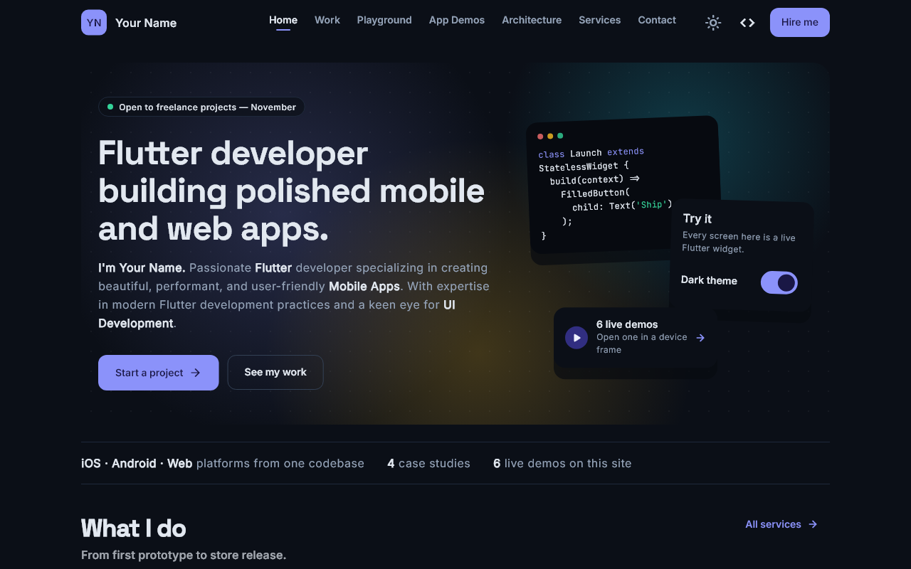

# Flutter Portfolio

A production-grade Flutter **web** portfolio: case studies, live app demos running in the page, and a **developer mode** that shows the real source behind every component.

**Live site:** _coming soon_ <!-- TODO(me): https://your-domain.dev -->

<!-- Regenerate: SHOT_DIR=docs SHOT_PATHS=/ SHOT_W=1280 SHOT_H=800 flutter test test/tool/screenshots_test.dart, then rename docs/home_1280_dark.png to docs/screenshot.png. -->


## What's inside

- **Landing page** that answers "who, what, how to hire" in one screen: an animated gradient-mesh hero, real facts (no invented numbers), services, featured work, skills grouped by category, and a process.
- **Work**: a filterable grid of case studies, plus a page per project (`/work/<slug>`) covering problem → solution → result, a Hero transition from card to header, and "next project" navigation.
- **Playground**: interactive UI components and product patterns (auth, dashboards, settings, empty and loading states), in tabs you can link to.
- **App demos**: six mini Flutter apps and motion studies that launch in a scalable phone frame (full-screen on mobile), with live, lazily built thumbnails.
- **Developer mode** (the `</>` button): every showcase component reveals the code it actually runs. Code is read from the bundled source between `// #region snippet` markers, highlighted, numbered and copyable, so it can never drift from reality.
- **Working contact flow**: validated form with project type and budget. It opens the visitor's mail client with everything prefilled; no backend needed.
- **Dark and light themes** from a hand-tuned palette, instant toggle, dark by default.

## Tech stack

| Area | Choice |
|---|---|
| UI | Flutter 3 (web first), Material 3, custom design system |
| State | Riverpod 3 (`Notifier`s with intent methods) |
| Routing | go_router 18 with a `ShellRoute`, path URLs, custom page transitions |
| Typography | Space Grotesk + Inter + JetBrains Mono via `google_fonts`, **bundled** (no CDN at runtime) |
| Links | `url_launcher` behind one helper that handles failures |
| Tests | `flutter_test`: 150+ unit and widget tests |

No animation, state or UI packages beyond these: every animation uses Flutter's own widgets.

## Project structure

```
lib/
  core/         app-wide: theme (design system), routing, state, content
    content/    all copy and data as const models  ← edit this to make it yours
  shared/       layout (AppShell, AppPage), demo framework, widgets, utils
  features/     one folder per area: landing, work, services, playground,
                ui_showcase, widget_gallery, app_simulator, architecture, contact
test/           unit + widget tests, helpers/pump_app.dart, tool/
docs/           architecture notes
```

See [docs/architecture.md](docs/architecture.md) for how the pieces fit.

## Make it yours

1. Fill in every `TODO(me)` in [lib/core/content/portfolio_content.dart](lib/core/content/portfolio_content.dart): name, email, links, real projects.
2. Put your name in [web/index.html](web/index.html) (title, Open Graph tags).
3. Regenerate the monogram icons from your name:
   ```bash
   GENERATE_ICONS=1 flutter test test/tool/generate_icons_test.dart
   ```
4. Add screenshots to `assets/images/` and set `imagePath` on the case studies.

## Run, test, build

```bash
flutter pub get
flutter run -d chrome            # develop
flutter analyze                  # must be clean
flutter test                     # unit + widget tests
flutter build web --release      # production build in build/web
flutter build web --release --wasm   # WebAssembly build (JS fallback included)
```

## Design decisions

- **Content is data.** Widgets never hard-code copy. Everything comes from `core/content` through Riverpod providers, so the site can be re-skinned or re-written without touching UI code.
- **Honest by construction.** Developer-mode snippets come from the real source files, and a test fails if a snippet marker disappears. Stats on the landing page are derived from the content or hidden until you supply them.
- **One persistent shell.** The navbar and drawer are built once by a `ShellRoute`; pages are thin content wrappers with their own scroll, so every page opens at the top.
- **Fast first paint.** Fonts are bundled and preloaded before the first frame, and the heavy demo pages are deferred (`deferred as`), so the landing page doesn't pay for them.
- **Accessible.** Keyboard Tab order starts in the navbar, icon buttons carry tooltips, tap targets are at least 44 px, layouts survive 1.3× text, and animations respect reduced motion.

## Deployment

A GitHub Actions workflow ([.github/workflows/deploy.yml](.github/workflows/deploy.yml)) runs analyze and tests, builds, and publishes to **GitHub Pages** on every push to `main`. To enable it: *Settings → Pages → Source: GitHub Actions*.

The app uses path URLs (`/work`, not `/#/work`), so the host must serve `index.html` for every path that isn't a real file. Otherwise a refresh or a shared deep link returns a 404.

| Host | Rewrite |
|---|---|
| GitHub Pages | the workflow copies `index.html` to `404.html` |
| Firebase Hosting | `"rewrites": [{ "source": "**", "destination": "/index.html" }]` in `firebase.json` |
| Netlify | `/*  /index.html  200` in `web/_redirects` |
| Vercel | `{ "rewrites": [{ "source": "/(.*)", "destination": "/index.html" }] }` in `vercel.json` |

On GitHub Pages the site lives under `/<repo-name>/`; the workflow passes that as `--base-href`. With a custom domain, change it to `/`.
